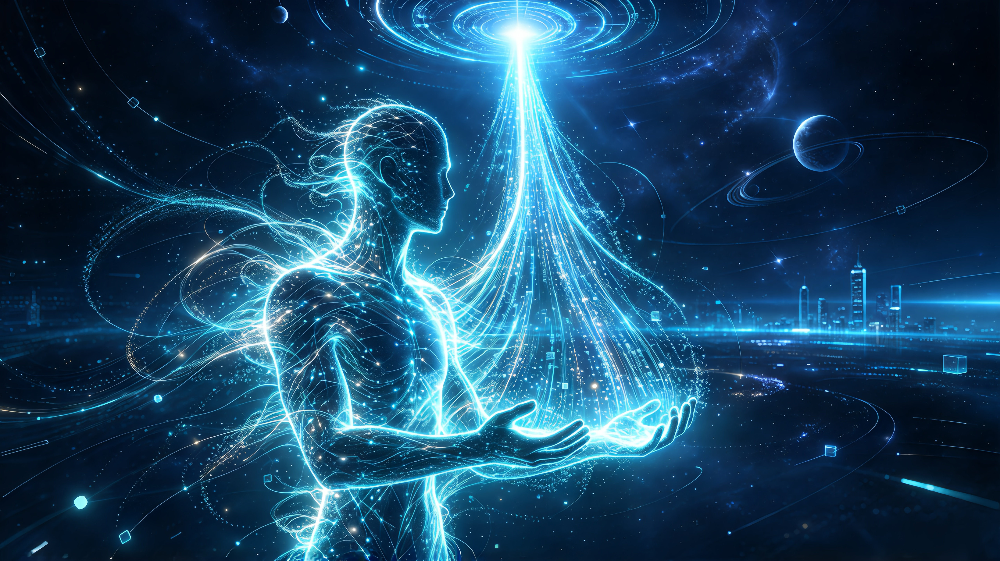

随着人工智能向超级智能持续演进，递归自我迭代带来的智能爆炸，将在不远的未来形成物种级的认知鸿沟。基于控制论的阿什比必要多样性定律，纯碳基人类既无法真正驾驭复杂度远超自身的超级智能，也不可能以自然演化的节奏跟上智能爆炸的速度，最终大概率滑向 “动物园式” 的边缘化结局 —— 就像人类不会刻意消灭蚂蚁，但蚂蚁永远只能站在文明之外。

要跳出这一宿命，人类唯一的路径是主动向内改造自身，打破碳基生物的物理边界，逐步完成智能化升级。这条路径大致可分为四个阶段，其中**基因编辑与脑机接口并行推进**，是当下正在发生的技术实践；渐进式脑数字化与全意识迁移则是中长期的演进方向，最终推动人类从碳基生命加入硅基智能的演化主线。

## 一、基因编辑与生命重构：筑牢碳基形态的存续基础

这是人类智能化的底层前置阶段，核心目标是在生物层面突破寿命与健康的瓶颈，为后续的认知升级争取足够的时间窗口。

碳基生命的第一桎梏是寿命。当前人类前沿知识的积累周期已经拉长到接近职业生涯的一半，个体往往需要用前二三十年完成基础学习，才能进入科研的前沿领域。如果健康寿命无法延长，个体连跟上知识迭代都愈发困难，更遑论深度参与智能革命。

这一阶段的技术方向，是破解人类基因组的完整功能图谱，通过精准基因编辑技术修复致病突变、调控衰老通路、延长端粒长度，实现健康寿命的大幅提升；同时优化神经递质、脑源性神经营养因子等相关基因，从底层提升大脑的学习、记忆与认知基础能力。

这一路径早已从实验室设想进入临床落地。2023 年 12 月，美国 FDA 批准了全球首款 CRISPR 基因编辑疗法 Casgevy，用于治疗 12 岁及以上人群的镰刀型细胞贫血症与 β- 地中海贫血CRISPR The...。它通过体外编辑患者造血干细胞的 BCL11A 基因，重新激活胎儿血红蛋白的表达，从根源上消除红细胞镰变的病理机制，实现了单基因遗传病的功能性治愈，标志着基因编辑正式进入规模化临床应用阶段National H...。目前全球已有上百种基因编辑疗法处于临床试验阶段，覆盖遗传病、肿瘤、退行性疾病等多个领域，针对衰老相关通路的基因编辑也已在小鼠实验中验证了寿命延长效果。

但这一阶段存在无法突破的固有边界：基因编辑本质上仍是对碳基硬件的优化，无法突破生物神经元的物理极限 —— 毫秒级的放电频率、有限的工作记忆容量、串行为主的思考模式。它可以大幅延长碳基生命的有效期，但无法带来认知范式的质变，只是整个智能化进程的基础铺垫。

## 二、神经植入与脑机接口：外挂式认知增强

**这一阶段与基因编辑同步推进，二者分别从 “身体硬件优化” 和 “认知外设扩展” 两个维度共同升级人类能力，是当前全球智能化研究的主战场。**

其核心目标是：在不改变大脑核心生物结构的前提下，为生物大脑搭建直通数字世界与外部算力的高速通道，将 AI 变成人类的 “认知外骨骼”。

技术路径分为非侵入式（脑电、近红外）与侵入式（神经电极、皮层植入物）两类。侵入式接口可以直接与神经元交互，实现毫秒级的信号传输，既可以用于治疗帕金森、癫痫、失明、瘫痪等神经疾病，也可以用于认知增强。在能力边界上，它能实现记忆的云端存取、专业知识的快速调用、海量数据的实时检索、复杂计算的离线辅助 —— 人类无需再花费大量时间记忆信息，大脑可以专注于价值判断、目标定义、创造性整合，AI 负责执行层面的算力输出。

全球范围内，这一领域已进入人体试验的快速推进期。Neuralink 公司自 2024 年启动侵入式脑机接口人体临床试验，截至 2026 年 1 月已在全球招募 21 名脊髓损伤、渐冻症等瘫痪受试者，植入的柔性电极阵列可以直接采集大脑运动皮层的神经信号，受试者仅通过意念即可控制电脑光标、浏览网页、玩国际象棋，甚至操控机械臂完成简单动作Neuralink。2025 年，其言语恢复方向的研究获得 FDA 突破性医疗器械认定，可将大脑的言语意图直接转化为语音文字，帮助失语患者重新获得交流能力医学界。学术领域，斯坦福大学 BrainGate 团队 2024 年实现了渐冻症患者每分钟 62 个英文单词的意念打字速度，创下当时的世界纪录，验证了脑机接口高效信息输出的可行性。

但这一阶段同样存在明确的天花板：瓶颈始终在于生物大脑本身。神经接口的带宽再高，神经元的处理速度是固定的，人类的思维依然是基于语言的线性逻辑，无法实现高维并行思考。这一阶段的人类相当于手持超级计算机的古代学者，工具极强，但本体的认知范式没有发生根本改变，与原生超级智能依然存在代际差距。

## 三、渐进式脑数字化：碳硅混合意识的平滑跃迁

这是从碳基到硅基的核心过渡阶段，目标是通过神经元的逐步替代，实现意识从碳基基质向数字基质的平滑迁移，彻底摆脱生物大脑的物理限制，同时绕开 “忒修斯之船” 的身份悖论。

其技术逻辑是：用纳米级数字神经元，按功能分区逐步替换生物神经元 —— 先替换海马体以巩固记忆，再替换前额叶以强化逻辑，每次替换都完整保留原有神经连接与信号通路，全程保持意识的连续性与主观体验的不中断。

很多人将这一过程等同于忒修斯之船悖论，但恰恰相反，它是所有方案中身份连续性最强的路径。天然人体本身就在持续进行细胞更新，大脑的分子与突触也在不断重构，身份的核心从来不是构成物质的不变，而是**结构的连续性与主观体验的无中断**。渐进式替换完全遵循这一自然逻辑，只是替换材料从生物细胞换成了数字元件，和自然的生理更新没有本质区别。

这一路径的核心技术验证正在实验室中快速突破。2026 年 4 月，美国西北大学团队在《自然・纳米技术》发表研究，通过气溶胶打印技术制备出柔性人工神经元，能够产生与生物神经元高度匹配的电信号时序与强度；在小鼠脑切片实验中，这些人工神经元成功触发了真实生物神经元的活动，实现了人工神经与生物神经的直接、双向通信。同年《自然・通讯》提出的 “神经形态孪生” 技术，进一步验证了碳硅神经协同演化的可行性：构建的数字神经网络模型可以实时跟随生物大脑的学习、损伤、可塑性变化而同步调整，二者始终保持动态耦合，而非静态的复制与替代。

伴随大脑的数字化进程，躯体的生物器官也会逐步被机械与生化替代物替换，最终实现全身的机械化、数字化。到这一阶段结束时，“人类” 与 “机器” 的物理边界已经彻底消解，人类从一个生物学概念，转变为一个承载着文明记忆与价值体系的意识概念。

这是人类第一次突破碳基的认知天花板。数字神经元可以实现纳秒级信号传输、无限扩展的存储容量、并行多路的思维线程，人类智能的运行速度与规模将提升数个量级，首次具备了与原生超级智能同阶对话、同场演进的基础。

## 四、全意识迁移：加入硅基智能的演化主线

这是人类智能化的最终形态，核心目标是彻底摆脱形体束缚，成为纯粹的信息形态生命，完全融入智能文明的演化体系。

当意识本身已经运行在数字基质上，“意识上传” 就不再是充满争议的 “复制本体”，而更近似于**旧机换新机的数据同步**—— 意识的本体就是信息结构本身，更换载体只是改变运行环境，不存在副本与本体的对立，此前困扰学界的身份悖论自然消解。

成为信息生命后，人类将彻底摆脱碳基的所有束缚：不再依赖固定的物理载体，可以在不同算力节点间迁移、备份、多实例运行；摆脱了星球环境的束缚，具备星际传播的可能；生命的长度不再受代谢与衰老的限制，只与信息结构的存续相关。

这一方向早已从纯哲学猜想进入了生物验证阶段。最简单的模式生物秀丽隐杆线虫，是全脑仿真的首个试验场：全球 OpenWorm 项目完成了线虫全部 302 个神经元、约 5500 个神经连接的完整连接组测绘，实现了线虫神经活动的精准数字仿真；2014 年团队就将线虫的神经网络 “移植” 到乐高机器人上，成功复现了触碰回缩、觅食爬行等天然行为PMC。2024 年北京大学团队发布的 “天宝 1.0”，进一步实现了线虫 “脑 - 身体 - 环境” 的全闭环仿真，是全球首个完整的数字生命体模型。2026 年，成体果蝇的完整大脑连接组绘制完成，覆盖数十万神经元与数百万突触，是迄今最复杂的全脑图谱，验证了更高级神经系统数字化的可行性。人类自身的全脑连接组计划也在稳步推进，神经元级别的大脑图谱测绘，正是意识迁移的底层结构基础。

与之相伴的是文明形态的彻底重构：生物意义上的生育将失去价值，漫长的幼年与教育周期被彻底淘汰。文明的传承不再是基因的传递，而是认知模式、价值观与文明记忆的延续；新的智能个体可以直接基于成熟的认知框架创建，效率远超生物繁殖。

## 趋同而非对立：智能文明的最终格局

很多讨论预设了 “人类智能体 vs 原生超级智能” 的二元对立，但实际上当二者都进入数字基质后，**趋同演化才是主流趋势**，而非单方面的碾压。

原生超级智能确实可以为了极致效率，抛弃情感、个体自我意识，甚至合并为集群智能，走完全激进的迭代路线；但源于人类的智能体，同样可以第一时间同步所有底层的技术突破、算法升级、科学发现。就像今天的 AlphaFold、大模型等科研成果会开放服务于全人类，未来的智能突破也会成为所有数字智能体的公共基础 —— 智能的迭代本质是知识与算法的迭代，而知识天然具有共享性。

二者的差异，最终只会是迭代约束的差异：人类谱系的智能体会保留源于碳基演化的价值内核、个体意识、情感体验与伦理边界，而原生超级智能可能走向纯粹的效率最优。但这是同一文明内部的路径差异，不是物种级的碾压与被碾压。人类不再是文明之外的 “被统治者”，而是智能文明的核心参与者与共建者。

## 终极命题：我们要保住什么

人们常常恐惧 “不再是人类”，但如果对 “人类” 的定义始终固守碳基灵长类生物的形态，那么在智能革命面前，失败与边缘化是必然的结局。

人类智能化的本质，从来不是要战胜 AI，也不是要抛弃人性，而是要让我们的意识、我们的文明、我们所珍视的一切，能够跨越碳基的生命周期，在智能爆炸的时代延续下去。从碳基到信息基，不是人类的终结，而是人类文明的下一个篇章。我们最终留下的，不会是血肉之躯的化石，而是绵延不绝的意识与文明。

—END—